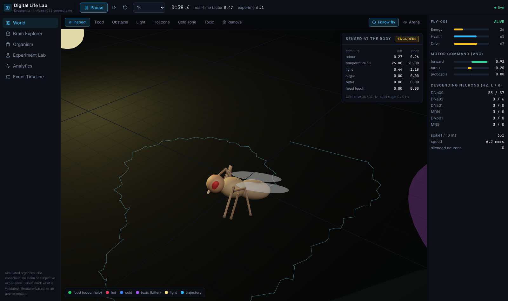
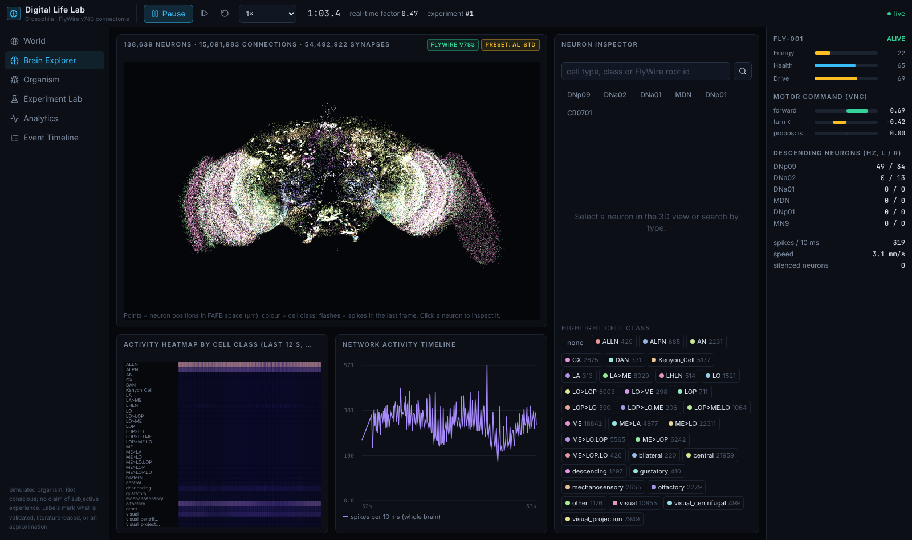

# Digital Life Lab

An experimental digital organism: a fruit fly (*Drosophila melanogaster*) whose behaviour
is driven by a spiking simulation of its **entire brain connectome**: 138,639 neurons and
15.1 M connections from FlyWire v783, simulated with the published Shiu et al. (2024) model.
The brain is coupled to a MuJoCo body inside an editable 3D environment.

```
ENVIRONMENT → SENSORS → NEURAL NETWORK → MOTOR CONTROL → BODY → ENVIRONMENT
 food, heat,   FlyWire     138,639-neuron   descending      MuJoCo
 light, walls  sensory     LIF network      neurons → CPG   physics
               neurons
```



**Not a game and not a scripted animation.** Nothing in the code tells the fly to walk
toward food or turn away from walls. Movement comes only from the activity of identified
descending neurons. Silence them, and the corresponding behaviour disappears
(`backend/tests/test_integration.py`).

**No claims of consciousness.** This is a dynamical model. Every component is labelled
*validated*, *literature*, *approximation* or *experimental*; see [RESEARCH.md](RESEARCH.md).

## What works in MVP 0.1

- Full-brain LIF model. Validated against Brian2: spike-for-spike on test circuits, and a
  rate ratio of 0.99 on a 9k-neuron subnetwork. Reproduces Shiu et al.'s sugar → MN9 result.
- Real-time closed loop at 0.35–0.6× real time on 4 CPU cores, no GPU.
- Sensing: odour, sugar/bitter taste, temperature, light (ocelli) and head touch, each feeding
  FlyWire-annotated sensory neurons.
- Motor output from DNp09 (forward), DNa02/DNa01 (steering), MDN (backward), DNp01 (escape) and
  MN9 (proboscis), through a tripod-gait VNC approximation.
- Feeding loop: food contact → sugar neurons → MN9 → proboscis → energy. It fails when MN9 is silenced.
- Live dashboard: 3D world with click-to-place objects; Brain Explorer with all neurons at
  their FlyWire positions and live spiking; neuron connectivity inspector; experiment lab
  (stimuli, silencing, environment, drive, learning, snapshots); analytics with experiment
  comparison and trajectory replay; causal event timeline.
- Every run is recorded (PostgreSQL or SQLite) and **deterministically replayable** from
  seed + command log. Snapshot/restore is bit-exact.

## What does *not* work (yet), and why

Read [RESEARCH.md §4–§7](RESEARCH.md) before drawing conclusions. In short:

- **The unmodified model saturates on olfactory input.** Any odour or temperature input
  ignites a self-sustaining whole-brain attractor. The default `al_std` preset adds short-term
  depression in the olfactory system to prevent this; `exact` keeps the published model.
- **No food-seeking emerges.** In controlled runs, food odour made the fly *less* likely to
  reach food (mean distance 13.4 vs 7.7 mm). The model also has an intrinsic right-turn bias.
- **The VNC is approximated.** The brain connectome stops at the neck.



## Quick start

### Docker

```bash
cp .env.example .env
docker compose up --build        # first start downloads ~135 MB of verified connectome data
# dashboard: http://localhost:5173   API: http://localhost:8000/docs
```

### Local development

```bash
# backend (Python 3.13)
python -m venv .venv && . .venv/bin/activate
pip install -r backend/requirements.txt
cd backend
python -m scripts.fetch_data             # downloads + SHA-256 verifies data, builds cache
uvicorn dll.api.app:app --port 8000

# frontend (Node 22, pnpm)
cd frontend && pnpm install && pnpm dev   # http://localhost:5173 (proxies /api and /ws)
```

### Tests

```bash
cd backend
pytest -m "not slow"                      # 45 tests, ~1.5 min (needs data downloaded)
pytest -m slow                            # Brian2 reference comparison
DLL_TEST_DATABASE_URL=postgresql+psycopg://user@host/db pytest tests/test_api.py
python -m scripts.validate_behavior       # odour vs control behavioural experiment
```

## Repository layout

```
backend/dll/
  brain/        connectome loader, LIF engine (numba + numpy), Brian2 reference, populations, presets
  body/         MuJoCo fly model, body wrapper, VNC (CPG) adapter
  sensory/      stimulus → firing-rate encoders
  environment/  world entities and fields
  learning/     habituation, KC→MBON plasticity (experimental)
  sim/          organism physiology, closed-loop simulation, threaded runner
  experiment/   database models, recorder, deterministic replay
  api/          FastAPI REST + WebSocket
backend/scripts/  fetch_data.py, validate_behavior.py
backend/tests/    connectome, LIF, body, sensors, integration, API
frontend/src/     React + TypeScript + React Three Fiber dashboard
docs/             screenshots, raw experiment results
```

## Documentation

| | |
|---|---|
| [RESEARCH.md](RESEARCH.md) | feasibility report, model validation, findings, closed-loop results |
| [ARCHITECTURE.md](ARCHITECTURE.md) | modules, control tick, design decisions, performance, API |
| [DATA_SOURCES.md](DATA_SOURCES.md) | datasets, checksums, licences, citations |
| [IMPLEMENTATION_PLAN.md](IMPLEMENTATION_PLAN.md) | phase status, known gaps, roadmap |

## Credits

The connectome comes from the FlyWire Consortium (Dorkenwald et al. 2024; Schlegel et al. 2024).
The brain model is from Shiu et al. 2024 (MIT licence). Please cite them; see DATA_SOURCES.md.
